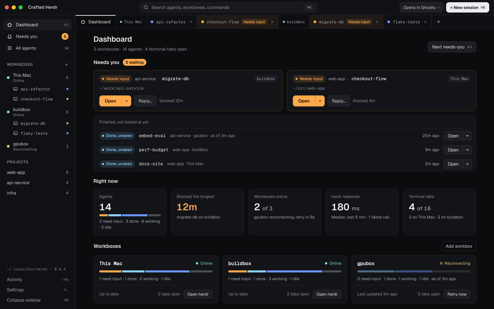
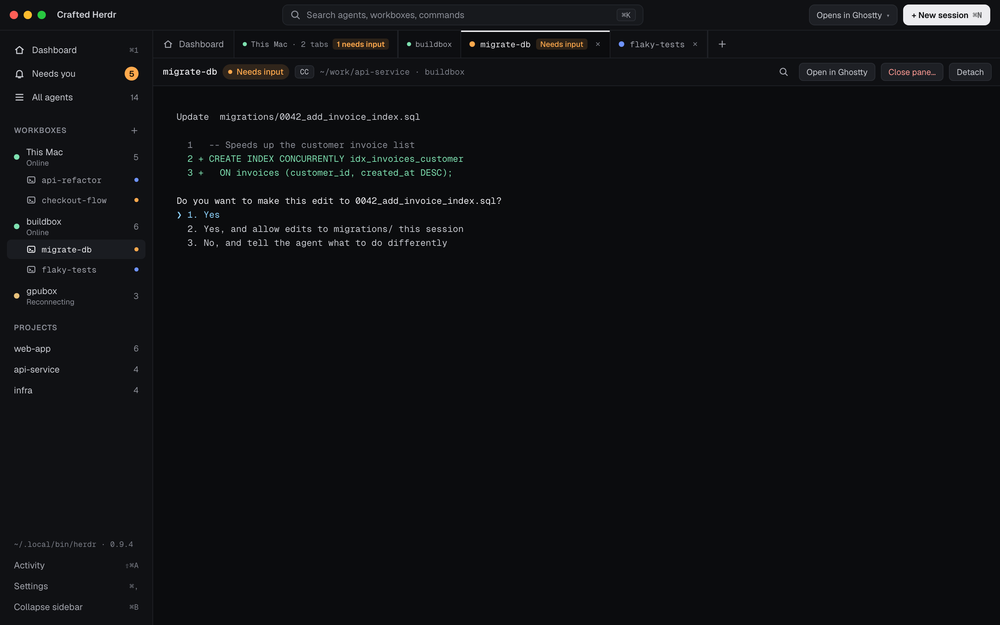

# Crafted Herdr

A desktop home for your Herdr agents: every workbox, every agent, grouped by project, with what needs you first.

Crafted Herdr is a macOS app (Tauri 2, React and TypeScript). It shows all your [herdr](https://herdr.dev) machines ("workboxes") and every terminal and agent on them in one window, opens any of them in the terminal you already use, and puts a menu bar item and notifications on top. It talks to your own installed herdr-core (`hc`), and it works beside Herdr, herdr's desktop app, on the same core.

Website: **[valencar.github.io/crafted-herdr-ui](https://valencar.github.io/crafted-herdr-ui/)**

> **Unofficial.** Crafted Herdr is an independent community project. It is not affiliated with, endorsed by, or part of herdr.dev or its authors.

## Screenshots





<sub>Rendered from the v0.3 design with sample data (workboxes `buildbox` and `gpubox`, projects `api-service`, `web-app` and `infra`); the running app follows the same layout.</sub>

## Features

- **A Dashboard home.** Who needs you, a few live numbers and the state of each workbox, on one screen. Blocked, errored and done agents sit at the top, ahead of everything else.
- **Tabbed workspace.** The Home tab (Dashboard, All agents or a Workbox screen) comes first; terminal tabs follow it, one workbox at a time (a row of workbox tabs over that workbox's tabs). A terminal takes the whole middle of the window.
- **One Open button.** "Open" attaches the terminal in a tab here, or in your own terminal app, by your Settings choice; its menu offers the other ways, Watch (read-only), Open in Herdr and copies the attach command. If you would rather use another terminal, "Open in {Terminal}" attaches it in Ghostty, iTerm2, Terminal, Warp, WezTerm, Kitty, Alacritty, or a command of your own.
- **Group by project, workbox, status or space.** In All agents, switch views instantly; the sidebar jumps to any group. Space is Herdr's own grouping, read from its layout (the app never changes it) and offered only when a workbox has one.
- **Command palette and fast navigation.** ⌘K finds agents, projects, workboxes and commands; ⌘J jumps to the next agent that needs you.
- **Dashboard beside the terminal and a native menu.** ⌘\ shows the Dashboard in a column next to the active terminal. The macOS menu bar carries every shortcut, and they work while a terminal has the keyboard.
- **Live preview and reply.** The inspector follows a terminal's recent output and lets you answer an idle agent. A blocked agent is never answered for you.
- **Shared with Herdr.** Seen and pinned are labels on the terminal, so an agent you looked at in Herdr is seen here too, and a pin follows it both ways. An agent that needs you shows why (permission, question or login) and a working one its progress; workers sit under the agent that started them.
- **Watch.** A read-only view of a terminal in its own tab: it shows what the program draws and sends it no keystrokes, the safe way to look at a blocked agent.
- **New session.** Start a shell, an agent or a template on any workbox, with the exact `hc run` command shown before you run it.
- **Workbox management.** Check, reconnect, log in, rename, hide, update hc there and forget workboxes. Add one through a guided sheet around `hc machine add`; the core's own errors say what to do next.
- **Menu bar and notifications.** A tray icon with a count, a compact "Needs you" popover, and a notification when an agent becomes blocked, errors or finishes.
- **Light, Dark or System theme.** Chosen in Settings; System follows macOS live, in the main window, the popover and Settings. Status is always shown as a shape plus words, never by color alone.
- **Activity drawer.** The `hc` commands the app runs are listed, with a Copy button. That includes the attach commands it runs in a tab of its own window ("opened in Crafted Herdr") and the ones it hands to your terminal. Version probes are not logged, and the regular reads (the machine list, the previews) are hidden until you turn on "Show reads".

## Requirements

- macOS 13 or later.
- [herdr-core](https://herdr.dev) 0.1.17 or later (`herdr-core`, also called `hc`), reachable on your `PATH` (the app also looks in `~/.local/bin`, `/opt/homebrew/bin` and `/usr/local/bin`, and lets you choose a binary in Settings). Install it first:

  ```bash
  curl -fsSL https://releases.herdr.dev/core/install.sh | sh
  ```

  There is no Homebrew formula for it. The app never installs it for you; if it can't find the core it shows this line with a Copy button.
- Optional: Herdr, herdr's desktop app, for "Open in Herdr" and Space grouping.
- For remote workboxes: machines saved with `hc machine add`, or added from the app's Add workbox sheet. The core on this Mac relays everything, so the app runs no `ssh` of its own.

### Coming from herdr 0.9

herdr 0.9 and its CLI (`herdr api snapshot`, `herdr terminal attach`, `herdr --machine …`) are retired, and this version of Crafted Herdr no longer works with them. If it finds only the old `herdr`, it says "You have herdr {version}, the older CLI" and shows the herdr-core install line. Your 0.9 workspaces, tabs and panes are not carried over: herdr-core's terminals are flat, and splits, tabs and worktrees are not core objects, so New session no longer offers them. Nothing of the old server is touched.

## Install

With [Homebrew](https://brew.sh):

```bash
brew install --cask valencar/tap/crafted-herdr
```

To upgrade later:

```bash
brew upgrade --cask crafted-herdr
```

Or by hand: download the latest `.dmg` from the [Releases](../../releases) page and drag **Crafted Herdr** to Applications.

Builds are not notarized yet, so macOS blocks the first launch, whichever way you installed it.

- On macOS 15 and later: try to open the app once, then go to System Settings › Privacy & Security, scroll to the message about Crafted Herdr and choose **Open Anyway**.
- On older versions: right-click the app and choose **Open**, then confirm.
- On any version, you can instead clear the quarantine flag once:

  ```bash
  xattr -dr com.apple.quarantine "/Applications/Crafted Herdr.app"
  ```

### Optional: Developer ID signing and notarization

Release builds are ad-hoc signed and not notarized. This is planned future work. The tauri CLI signs and notarizes when it finds these environment variables, but the release workflow's `build` job is deliberately read-only and secret-free, because it runs the project's dependency code. Enabling Developer ID signing means adding a separate `sign` job between `build` and `publish`. That job receives these values as repository secrets and runs only Apple's own tools (`codesign`, `notarytool`, `stapler`) on the downloaded build artifact, never dependency code. Signing the `.app` inside the DMG also means rebuilding the DMG there (with `hdiutil`), because tauri produces the DMG's layout at build time and its contents would otherwise stay ad-hoc signed. The values are:

- `APPLE_CERTIFICATE` and `APPLE_CERTIFICATE_PASSWORD` (a base64 Developer ID Application certificate and its password)
- `APPLE_SIGNING_IDENTITY`
- `APPLE_ID`, `APPLE_PASSWORD` (an app-specific password) and `APPLE_TEAM_ID`, or an App Store Connect API key (`APPLE_API_ISSUER`, `APPLE_API_KEY`, `APPLE_API_KEY_PATH`)

## How it uses herdr-core

Crafted Herdr talks to herdr-core only through its public interfaces: the `hc` command line and the documented JSON-RPC API that `hc connect` carries. It never opens the core's socket itself. One connection subscribes to the core's event stream, which covers every machine you added, so changes show up as they happen instead of being polled. These are the calls it makes:

| What you do | What it runs |
|---|---|
| Keep state fresh | `events.subscribe` (one stream), `machine.list` every 10 s, `hc --version` |
| Open a terminal | a tab in the app, or your terminal, runs `hc attach <address>` (`hc attach buildbox/t7` for another workbox: the local core relays it); Watch runs `hc attach --observe <address>` |
| Open in Herdr | `herdr-app do terminal.peek '{"terminal":"<address>"}'`, only while Herdr's window is open |
| New session | `terminal.run` (`hc run …`), labelled `herdr.seen=0`, on this Mac or on a workbox |
| Reply | `terminal.send` (`hc send <address> "<text>"`), only for idle or done agents and never forced |
| Interrupt | `terminal.interrupt`, presses the stop key once |
| Seen, unread, pin | `terminal.label` with `herdr.seen` and `herdr.pinned` |
| Keep | `terminal.keep` |
| Close, Remove | `terminal.kill` (always after a confirmation), `terminal.rm` for an ended one |
| Preview | `terminal.read` with `lines: 0`, only for what is on screen |
| Spaces | `doc.get` of Herdr's `herdr-app` document, read only |
| Manage workboxes | `machine.connect`, `machine.rename`, `machine.rm`; Log in… and Update hc there… run `hc machine login` and `hc machine update` in a tab |
| Add a workbox | `machine.add` (`hc machine add <target> [--name …] [--session …] [--temp]`) |
| Agents on a workbox | `machine.exec` (`command -v …`, read-only) to offer only the agents installed there |

The commands are visible in the **Activity drawer** (⌘⇧A): the calls the app runs itself, and the ones it opens in a tab of its own window (marked "opened in Crafted Herdr") or in your terminal (marked "opened in …", since the app can't see how they end). Version probes are not logged. The app never installs herdr-core, updates or stops a core, answers a blocked agent, or forgets a machine without an explicit click from you. One thing happens on its own: `hc` starts a stopped local core when anything connects to it, so launching the app can start your core. If the core goes away the app retries for two minutes (long enough for `hc update`), then waits for you to press **Reconnect**.

## Workspace and Dashboard

The middle of the window is a two-row tab strip with the active tab under it, at full size. The top row has Home and one tab per workbox that has open terminal tabs; the second row shows that workbox's tabs (or, on Home, the Home views).

- **Home tab.** It is first, always there and never closable (⌘W does nothing on it). It shows the Dashboard by default, All agents (the searchable list with its Inspector and grouping) or a Workbox screen. The tab itself always reads "Home"; what it shows is named in the Home views row. ⌘1, the sidebar's Dashboard item and the palette's "Go to Dashboard" bring it back.
- **Workbox row.** Home first, then one tab per workbox that has open terminal tabs, with its health dot, its tab count and a "needs input" badge when one of its tabs waits on you. Clicking a workbox goes back to the tab you last used there, or its first tab.
- **Tabs row.** Under a workbox, its terminal tabs, each with a status dot, its title and a second line, "{project or folder} · {status}", with the status in words ("Working", "Needs input", "Detached"…), then **New on {workbox}** (the new-session sheet, prefilled with that workbox) and, when the tabs don't fit, a scroll with the active tab kept in view and an **All tabs** menu that lists every tab by workbox with its status. On Home, this row holds the Home views instead: Dashboard, All agents or a workbox screen. ⌘2–⌘9 still count tabs across all workboxes in the order they appear.
- **Switching keeps the terminal.** Moving to Home and back never loses scrollback or detaches anything. Closing the active terminal tab returns to Home.
- **Context bar.** Above the active terminal: the agent, its status, kind, folder and workbox, then Find (⌘F), **Open in {Terminal}**, **Detach** (the same as ⌘W) and the ⋯ menu (copy the attach command or address, Watch, Mark as seen or unread, Pin, Interrupt, Keep, **Close…** with its confirmation). A Watch tab says "Watching (read-only)" and sends nothing. A command tab (Log in…, Update hc there…, an add) shows only Find and Close tab.
- **Sidebar.** Dashboard (⌘1), Needs you and All agents with counts, then each workbox with its health, its agent count and its open terminals nested under it, then the first three projects ("{n} more" shows the rest). ⌘B collapses it to a rail.

The **Dashboard** reads top to bottom:

- **Needs you.** Cards for agents waiting on you, blocked first, then oldest, each with its status and age and an Open button. A list of finished, not looked at yet agents follows. With nobody waiting it says "Nobody needs you right now." Cards show no terminal preview; click one (or its Details…) to open All agents on that row, where the preview and reply live.
- **Right now.** Five tiles: Agents (a bar by status, with its text legend), Blocked the longest, Workboxes online, Core response (the median time of herdr-core calls over the last 5 minutes, and how many failed) and Terminal tabs ("{n} of 16", by workbox).
- **Workboxes.** A card per workbox with its health in words, a status bar, "Up to date" (or, when it isn't online, "Last updated 2m ago"), its open tabs, and **Retry now** (reconnecting or needing attention). A workbox that isn't online shows its last data dimmed, marked "as of {age} ago".
- **Working now.** Working agents, longest-running first, each with an Open button, and a link to All agents.

The Dashboard makes no herdr-core calls of its own. It reads the app's state and, only while it is visible, the in-memory command log once every 5 seconds for the response tile.

**⌘\** shows the Dashboard in a resizable column (360 to 1200 px, remembered) on the right of the active terminal, in a single-column layout. Press it again to hide the column. On the Home tab it does nothing.

### The Open button

One split button opens an agent everywhere: needs-you cards, the Dashboard's lists, the Inspector and the Workbox screen. **Open** follows Settings › Open sessions in (a tab here, or your terminal app). Its chevron menu has **Open here**, **Open in {Terminal}**, **Watch (read-only)**, **Open in Herdr** (only while Herdr's window is open) and **Copy attach command**, which copies the attach command that "Open in {Terminal}" would run. A blocked agent also gets a Watch button beside Open. When the row is already open in a terminal tab the button reads **Go to tab** (with its ⌘ number when it has one).

## Terminal inside the app

"Open" attaches the terminal in a tab inside the window. The tab runs the same command "Open in {Terminal}" runs: `hc attach <address>`, the same for this Mac and for a remote workbox (the local core relays it, so there is no `ssh` and no takeover prompt). The app only ever runs the command it builds itself; nothing you type is turned into a command.

- **Tabs.** Each tab shows its title and a status dot, with a second line, "{project or folder} · {status}", that spells the state out in words ("Needs input", "Done, unseen", "Detached"…); the tooltip reads "{status} (⌘n)". Only a tab whose agent is blocked gets the orange tint. Tabs stay open when you move between the Home tab's screens. ⌃` switches between Home and the last terminal tab. Opening a terminal that already has a tab focuses that tab. At most 16 tabs can be open at once.
- **Closing only detaches.** Closing a tab (× or ⌘W), choosing Detach, quitting the app or a crash ends the attach client and nothing else: your terminal and its agent keep running. "Close…" (which ends the program) is a separate action and always asks first. When an attach ends by itself (the detach key, the program ending, the core stopping), the tab stays open and says which, with **Reattach** (Enter) and **Close tab** (⌘W); a tab whose terminal ended or is gone offers Close tab only. A tab that lost the core reattaches by itself once the core is back, and a kept terminal whose shell was lost reattaches when its new shell starts. Closing the active tab returns you to the Home tab.
- **Tabs are not restored at launch.** The app never reattaches by itself, so it never takes a session over without you.
- **Log in and install prompts** (Log in…, Install hc there…, a password for an add) appear inside a command tab, and you answer them there.
- **Typing belongs to the terminal.** Keys typed in the terminal (Backspace, arrows, ⌃C and the rest) never trigger the list shortcuts of All agents. Menu shortcuts still work. ⌘C and ⌘V copy and paste. ⌘F finds in the active terminal, and ⌘+, ⌘− and ⌘0 change the font size (saved).
- **Links are copy-only.** ⌘-click on a URL copies it and shows "Link copied". The app opens no web link other than https://herdr.dev.
- **Open in still available.** Settings › Terminal › "Open sessions" (In Crafted Herdr, or in your terminal app) chooses what "Open" does everywhere (rows, needs-you cards, the Inspector, ⌘↩, the palette, notifications and the menu-bar popover): open here, or in your terminal app. The Open button's menu always offers the other choice, and ⌘↩ in the palette opens the other way.
- **Layout settings.** Window size and position, whether the Dashboard column is shown and its width, terminal font size, the collapsed sidebar and row density (comfortable or compact, in Settings › Appearance) are remembered.

## Terminal support

These are the external terminals "Open in {Terminal}" can use.

| Terminal | How a session opens |
|---|---|
| Ghostty | `open -na Ghostty --args -e …`; always a new window |
| iTerm2 | AppleScript; a new window, or a new tab in the current window (Settings) |
| Terminal | AppleScript (`do script`) |
| Warp | A launch configuration in `~/.warp/launch_configurations/` (kept on disk, see Privacy), opened through `warp://launch/…` |
| WezTerm | `open -na WezTerm --args start -- …` |
| Kitty | `open -na kitty --args …` |
| Alacritty | `open -na Alacritty --args -e …` |
| Custom | Your own command template; `{attach}` is replaced by the attach command |

iTerm2 and Terminal are driven with AppleScript, so macOS asks for **Automation** permission the first time. Allow it in the prompt, or later in System Settings › Privacy & Security › Automation.

## Keyboard shortcuts

The native menu bar owns these, so they work while a terminal has the keyboard, and you can find them in the menus.

| Shortcut | Menu | Action |
|---|---|---|
| ⌘/ | View | Keyboard shortcuts sheet |
| ⌘K | View | Command palette (also "Go to Dashboard", "All agents" and "Dashboard beside terminal") |
| ⌘1 | View | Dashboard (the Home tab) |
| ⌃` | View | Switch between Home and the last terminal tab |
| ⌘\ | View | Show the Dashboard beside the terminal (does nothing on Home) |
| ⌘B | View | Collapse or expand the sidebar |
| ⌘J | View | Open the next agent that needs you |
| ⌘F | View | Find in the terminal, or search All agents (on Home it opens All agents and focuses its search) |
| ⌘= / ⌘− / ⌘0 | View | Bigger, smaller, reset terminal font |
| ⇧⌘A | View | Activity drawer |
| ⌘W | Terminal | Close (detach) the active terminal tab (nothing on Home) |
| ⌃Tab / ⌃⇧Tab | Terminal | Next / previous tab, Home included |
| ⌘2 … ⌘9 | Terminal | Go to terminal tab 1 … 8, in strip order |
| ⌘, | Crafted Herdr | Settings |

Edit has the usual Undo, Redo, Cut, Copy, Paste and Select All. Crafted Herdr has About, Hide, Hide Others, Show All and Quit (⌘H, ⌥⌘H, ⌘Q), and Window has Minimize and Bring All to Front (⌘M for Minimize). There is no Close Window item, so ⌘W on Home does nothing; the red button still hides the window.

These work on the Home tab when the focus is not in a terminal. ⌘N and ⌘R work on the Dashboard too; the rest act only while Home shows All agents:

| Shortcut | Action |
|---|---|
| ⌘N | New session |
| ⌘↩ | Open the selected row in All agents (here or in your terminal, by your Settings choice) |
| ⌘R | Refresh |
| ⌫ | Close the selected session in All agents (asks first) |

One shortcut is global rather than in a menu: ⌃⌥⌘H shows or hides the app from anywhere (it can be turned off in Settings).

## Privacy

- Warp is opened through a launch configuration the app writes to `~/.warp/launch_configurations/crafted-herdr-*.yaml`. These files stay on disk and contain the attach command (the terminal's address, such as `buildbox/t7`). Delete them if you don't want them kept.
- The app makes no network calls of its own. Everything goes through your herdr-core, and SSH to a remote workbox is done by the core and OpenSSH.
- Your SSH keys and agent stay with OpenSSH. The app stores no passwords, keys or tokens, and only reads `Host` aliases from `~/.ssh/config` to suggest targets.
- No telemetry, no analytics, no accounts.
- The one link it can open is https://herdr.dev, from the "herdr-core wasn't found" screen. Links in a terminal tab are copied, never opened.
- The terminal fonts and code are bundled with the app; nothing is loaded from the web.

## Development

Requirements: Node 24 or later, pnpm 10, a stable Rust toolchain.

```bash
pnpm i && pnpm tauri dev     # run the app
pnpm test                    # Vitest
pnpm lint && pnpm typecheck
cd src-tauri && cargo test && cargo clippy --all-targets -- -D warnings && cargo fmt --check
```

- **fake-hc.** `scripts/fake-hc` is a test double for `hc` (JSON-RPC over `hc connect`, `--version`, `attach`). Unit and integration tests run against it, so no test ever touches a real core.
- **Live test.** `src-tauri/tests/live.rs` is `#[ignore]` and runs only with `HERDR_UI_LIVE=1`, against a sandbox core of its own: `HC_SESSION=herdr-ui-qa` with its own `XDG_STATE_HOME`, `XDG_CONFIG_HOME` and a short `XDG_RUNTIME_DIR` (see the file's header). It refuses to run anywhere else, creates one terminal labelled `herdr-ui-qa=1`, reads, kills and removes it, and touches nothing else. Its remote leg runs only when `HERDR_UI_TEST_MACHINE` is an ssh target (or Host alias) that `hc machine add` can reach.
- **`.env.local`.** Copy `.env.local.example` to `.env.local` (gitignored) for anything personal: the opt-in live test settings (`HERDR_UI_LIVE=1`, `HERDR_UI_TEST_MACHINE`) and private patterns for the data check. Real machine names, hosts and paths live only there.
- **Personal-data check.** Run `scripts/check-no-personal-data.sh` before every commit. It fails if a home path, key or any of your private patterns is in the repo.
- **Test builds.** Every pull request's CI run attaches a test DMG (the `preview` job's summary links it; ad-hoc signed like a release, kept 14 days) so a change can be tried without building it.

Examples in the code, tests and docs use generic names only: workboxes `buildbox` and `gpubox`, project `api-service`. See [CONTRIBUTING.md](CONTRIBUTING.md) and [CLAUDE.md](CLAUDE.md). The design specs are kept locally by the maintainer (`docs/superpowers/`, not in the repo).

## License

[MIT](LICENSE)
